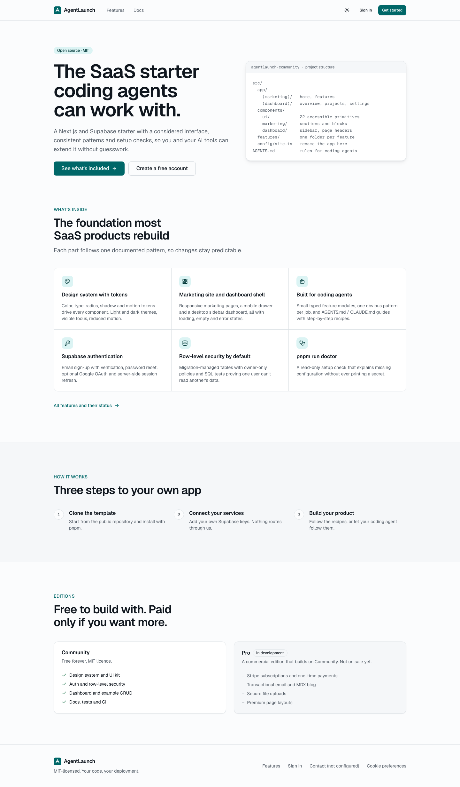

# AgentLaunch Community

**A SaaS starter coding agents can work with:** Next.js, Supabase and a polished, accessible design system, under the MIT licence.

> **Status: v0.1.0 release candidate.** The UI, auth, per-user data with row-level security, email, analytics, setup checks and agent guides all work today. Next releases add the `npx create-agentlaunch` installer, a blog, file uploads, an AI demo, Stripe billing and a basic admin. See [docs/FEATURE_MATRIX.md](docs/FEATURE_MATRIX.md) for exactly what's shipped.



## Who it's for

Solo founders and developers, including people building with AI coding agents, who want a clean, typed foundation they can change confidently.

## What you get

- Next.js 16 App Router, React 19, TypeScript strict, Tailwind CSS 4, pnpm
- A design-token system (color, type, radius, shadow, motion), light/dark/system themes with no flash on load, and reduced-motion support
- 22 accessible UI components on Radix primitives: button, input, textarea, select, checkbox, switch, tabs, card, badge, dialog, sheet, dropdown menu, toast, table, skeleton, alert, avatar, separator, label, form field, empty state, error state
- Marketing home and features pages, mobile navigation, and a dashboard shell with a sidebar and mobile drawer
- Branded 404, error and loading states; metadata, sitemap, robots and a generated Open Graph image
- Vitest unit tests, Playwright smoke tests at 375px and 1440px, and GitHub Actions CI

- Supabase Auth: email sign-up with confirmation, sign-in, sign-out, password reset, and optional Google, GitHub, Microsoft and Slack sign-in. Sessions are refreshed in `src/proxy.ts`
- `profiles` and `projects` tables with explicit grants and owner-only row-level security, proven by 22 pgTAP tests (two users plus anonymous)
- Project create / edit / delete and profile settings, with Zod validation on client and server, toasts, and empty, loading and error states
- An open-redirect guard on `?next=`, generic auth errors (no account enumeration), and per-IP rate limits on auth actions
- Email through Resend or any SMTP provider, with a once-only welcome email
- Plausible or Google Analytics, with a cookie-consent banner that keeps GA off until visitors accept
- `pnpm run doctor`: a read-only setup check that never prints secrets
- Deploy guides for Vercel, Docker, Railway and Fly, plus a production `Dockerfile`
- Built for AI coding agents: `AGENTS.md` recipes, Claude Code skills, Cursor rules and `llms.txt`
- Automated accessibility checks (axe) on every page in light and dark mode

## Quickstart

Requires Node 22+.

```bash
corepack enable pnpm
pnpm install
cp .env.example .env.local
pnpm db:start                     # needs Docker; see docs/LOCAL_SUPABASE.md
pnpm exec supabase status         # copy API URL + Publishable key into .env.local
pnpm run doctor                   # checks your setup; never prints secrets
pnpm dev                          # http://localhost:3000
```

Sign up at `/signup`, then open the confirmation email in Mailpit at http://127.0.0.1:54324. Or sign in with the local demo account `demo@agentlaunch.local` / `demo-password-123`, which is seeded locally only.

## Scripts

| Command                                                     | What it does                                                                             |
| ----------------------------------------------------------- | ---------------------------------------------------------------------------------------- |
| `pnpm dev`                                                  | Dev server                                                                               |
| `pnpm check`                                                | Lint + typecheck + unit tests + production build                                         |
| `pnpm lint` / `pnpm typecheck` / `pnpm test` / `pnpm build` | Individual checks                                                                        |
| `pnpm format` / `pnpm format:check`                         | Prettier                                                                                 |
| `pnpm test:e2e`                                             | Playwright against a production build (run `pnpm exec playwright install chromium` once) |
| `SCREENSHOTS=1 pnpm test:e2e screenshots`                   | Regenerate `docs/screenshots/`                                                           |

## Project structure

```
src/
  app/
    (marketing)/       /, /features
    (auth)/            /login, /signup, /reset-password
    (dashboard)/       /dashboard, /dashboard/projects, /dashboard/settings
    auth/callback/     email-link and OAuth code exchange
  components/
    ui/                design-system primitives
    marketing/         header, footer, sections
    dashboard/         sidebar nav, page header
    theme/             theme script and toggle
  features/            one folder per feature: schema.ts, actions.ts, queries.ts, components/
  config/site.ts       app name, nav, links: rebrand here
  lib/supabase/        server client, proxy session refresh, generated DB types
  lib/permissions/     requireUser(): server-side auth for every data path
  proxy.ts             session refresh + signed-out redirect
supabase/migrations, supabase/tests, supabase/seed.sql
tests/unit, tests/e2e
docs/                  feature matrix, changelog, test results, screenshots
```

## Customising

- **Rename the app:** edit `src/config/site.ts`.
- **Change the look:** edit the tokens in `src/app/globals.css`. Each token has a light value and a `.dark` value.
- **Environment:** see `.env.example`. The two Supabase variables are required.
- **Guides:** [Auth and social sign-in](docs/AUTH_SETUP.md) · [Local Supabase](docs/LOCAL_SUPABASE.md) · [Email and analytics](docs/EMAIL_AND_ANALYTICS.md) · [Deploy](docs/DEPLOY.md) · [Troubleshooting](docs/TROUBLESHOOTING.md) · [Security checklist](docs/SECURITY_CHECKLIST.md)
- **Working with an AI agent:** point it at [AGENTS.md](AGENTS.md). Claude Code also picks up the skills in `.claude/skills/`, and Cursor the rules in `.cursor/rules/`.

## Community vs Pro

Pro is a commercial edition **in development and not for sale yet**. It is planned to add Stripe billing, email, a blog, file uploads and premium layouts. Community stays fully usable on its own. See [docs/FEATURE_MATRIX.md](docs/FEATURE_MATRIX.md).

## Contributing and security

See [CONTRIBUTING.md](CONTRIBUTING.md), [CODE_OF_CONDUCT.md](CODE_OF_CONDUCT.md) and [SECURITY.md](SECURITY.md).

## Licence

[MIT](LICENSE). Your deployed app contains no licence checks and no dependency on us.
